  
  
    
  
  
  

  
   

 
 

#### 📍 St. John's, Newfoundland 
---

> 🌤️ Weather: ☁️ 4°C • Overcast • H:5°C • L:3°C • 2.0mm rain

> 🕒 Last Updated: 2026-11-08 09:27

---

# 💫 About Me

🏢 Sr. Software Engineer @Nasdaq. 
🌱 Productionizing SOTA AI Agents to catch Fraud and Money Laundering. 
💬 Ask me about LLMs, Diffusion Models, and AGI. 
👓 Actively Maintaining [Open Wallpaper Engine.](https://github.com/deepratna-awale/open-wallpaper-engine-mac) 

# 🌐 Socials

   

# 💻 Skills

<table>
  <tr><td align="left" nowrap><b>Languages</b></td><td align="left">    </td></tr>
  <tr><td align="left" nowrap><b>AI & ML</b></td><td align="left">          </td></tr>
  <tr><td align="left" nowrap><b>Web & Backend</b></td><td align="left">     </td></tr>
  <tr><td align="left" nowrap><b>Data</b></td><td align="left">         </td></tr>
  <tr><td align="left" nowrap><b>Cloud & DevOps</b></td><td align="left">        </td></tr>
  <tr><td align="left" nowrap><b>Workstation</b></td><td align="left">      </td></tr>
</table>

# 📊 GitHub Stats

 

## 🏆 GitHub Trophies

## 📄 Research Papers

| **Published Research** |
|------------------------|
| **[Theoretical Answer Evaluation System (T.A.E.S)](https://www.academia.edu/81925526/Theoretical_Answer_Evaluation_System_T_A_E_S_)** - A comprehensive system for evaluating theoretical answers |
| **[Semantic Analysis of Long Answers](https://www.academia.edu/48840919/SEMANTIC_ANALYSIS_OF_LONG_ANSWERS)** - Research on semantic analysis techniques for extended responses |

---

# 💰 You can help me by Donating

| **Support my work** |
|---------------------|
|    | 

